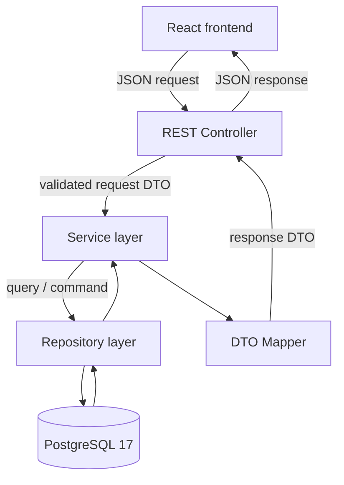

# TeamUp MSR + DTO architecture

## Responsibilities

- **Controller:** HTTP routing, input binding, bean validation, HTTP response codes. No SQL or domain transaction logic.
- **DTO request:** API input contract; never bind request JSON directly to a persistence entity.
- **Service:** authorization, validation that depends on stored state, business workflows, transaction boundaries.
- **Repository:** parameterized SQL and persistence projections. Avoid controller-to-database access.
- **Model:** domain data concepts. Flyway migration defines the actual relational schema.
- **DTO mapper:** translates persistence/domain values into response contracts and prevents accidental exposure of internal columns.

## Important consistency constraints

- `teams.source_post_id` is unique, so one recruitment post creates at most one team.
- `team_members` partial unique indexes prevent duplicate active membership and more than one active leader per team. Service logic must still ensure an active team has exactly one leader.
- Pending join requests are unique per `(post_id, requester_id)`.
- OAuth identity is keyed by Google `sub`, not display name.
- Google sign-in is the only login method; TeamUp API access uses its own short-lived access JWT.

The model records in this starter are domain projections; persistence currently uses JDBC repositories and Flyway rather than JPA entity mapping. Keep that explicit if adding JPA later—do not mix two schema authorities.
